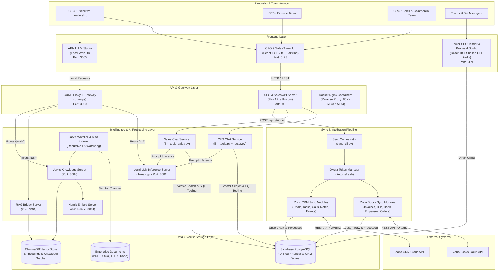
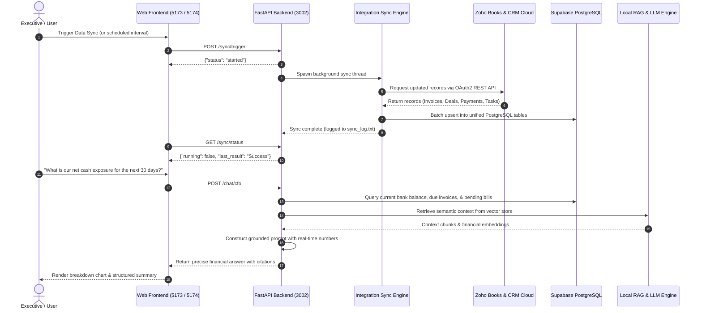

# Tower-CEO (Executive Control Tower & Enterprise Intelligence Suite)

[](docker-compose.yml)
[](backend/cfo_tower/cfo_server.py)
[](frontend-cfo/)
[](frontend-tender/)
[](backend/)
[](backend/rag/)

**Tower-CEO** is an all-in-one Executive Operations, Financial Cockpit, and AI-powered Proposal & Tender Intelligence Platform. It unifies financial forecasting, sales pipeline visibility, automated ERP/CRM data synchronization, tender bid management, and private on-premise Retrieval-Augmented Generation (RAG) into a single, cohesive command center for executive leadership (CEOs, CFOs, CROs, and Tender Directors).

---

## Table of Contents
1. [The Problem Statement](#the-problem-statement)
2. [What We Solve (The Solution)](#what-we-solve-the-solution)
3. [System Architecture](#system-architecture)
4. [Component Deep Dive](#component-deep-dive)
   - [1. CFO & Sales Control Tower (Frontend)](#1-cfo--sales-control-tower-frontend)
   - [2. Tower-CEO Tender & Proposal Studio (Frontend)](#2-ais-insight-flow--tender-studio-frontend)
   - [3. CFO & Sales Intelligence Server (Backend)](#3-cfo--sales-intelligence-server-backend)
   - [4. AI Gateway & Local CORS Proxy](#4-ai-gateway--local-cors-proxy)
   - [5. Jarvis RAG & Multi-Modal Knowledge Engine](#5-jarvis-rag--multi-modal-knowledge-engine)
   - [6. ERP & CRM Data Synchronization Engine](#6-erp--crm-data-synchronization-engine)
5. [End-to-End Data Flow](#end-to-end-data-flow)
6. [Tech Stack](#tech-stack)
7. [Directory Structure](#directory-structure)
8. [Setup & Quickstart Guide](#setup--quickstart-guide)
   - [Option A: Docker Compose (Recommended)](#option-a-docker-compose-recommended)
   - [Option B: Local Development Setup](#option-b-local-development-setup)
9. [Environment Variables Reference](#environment-variables-reference)
10. [Service Ports & Endpoints](#service-ports--endpoints)
11. [Security, Privacy & Governance](#security-privacy--governance)

---

## The Problem Statement

Enterprise leadership and fast-scaling organizations constantly struggle with disjointed operational systems:

1. **Siloed Financial & Sales Realities**:
   - Financial ledgers (Zoho Books: invoices, vendor bills, payments, expenses, bank feeds) and customer pipelines (Zoho CRM: deals, stages, contacts, tasks) sit in disconnected silos.
   - Executives cannot easily correlate sales pipeline momentum with actual cash in bank, project billing milestones, and forecasted P&L.
2. **Lagged Decisions & Cash Flow Blind Spots**:
   - Traditional financial reporting depends on manual month-end consolidations, leading to delayed decision-making, missed vendor credit deductions, unbilled sales orders, and unspotted stalled deals.
3. **High-Stakes, Manual RFP & Tender Execution**:
   - Responding to complex commercial tenders (RFPs/bids) takes weeks of manual work across fragmented spreadsheets, disparate technical documents, legal compliance checks, and pricing margin calculations.
4. **Data Privacy Risks with Generic Public AI**:
   - Enterprise teams want generative AI and intelligent search over internal contracts, balance sheets, and proprietary codebases, but sending proprietary financial and legal data to third-party cloud APIs poses critical compliance and IP leak risks.

---

## What We Solve (The Solution)

**Tower-CEO** provides a unified, real-time operating system that connects business execution to executive decision-making:

- **Executive Financial Cockpit**: Real-time cash flow monitoring, forecasted Profit & Loss (P&L), automated bank reconciliation, expense categorizations, and exceptions monitoring.
- **Sales Intelligence & Deal Health**: Pipeline stage distributions, win-rate analytics, stalled-deal detection algorithms, and weekly sales review boards with real-time sync from CRM.
- **End-to-End Tender & Proposal Engine (`frontend-tender`)**: AI-assisted RFP parsing, Go/No-Go tender qualification scoring, automated commercial pricing & margin rules, legal clause library verification, dynamic proposal authoring, and multi-tier approval workflows.
- **Automated Zoho Integration Pipeline**: Multi-threaded sync pipelines synchronizing 20+ Zoho Books and Zoho CRM entity types into a unified PostgreSQL schema with zero manual intervention.
- **Private, Air-Gapped / Local RAG Engine (Jarvis)**: In-house vector embeddings and knowledge graph generation over documents (PDF, DOCX), complex multi-tab Excel models, code repositories, and web assets using local GPU inference (Qwen/Gemma via LLaMA.cpp + Nomic embeddings).
- **Executive AI Assistants**: Role-specific AI conversational agents for CFOs (finance/cash questions) and Sales Leaders (pipeline/deal questions) grounded in live database queries.

---

## System Architecture



---

## Component Deep Dive

### 1. CFO & Sales Control Tower (Frontend)
Located at [`frontend-cfo/`](frontend-cfo/) (Port `5173`):
- **Cash Flow Dashboard**: Visualizes projected vs. actual inflows, outflows, and net cash positions.
- **Forecasted P&L**: Dynamic income, COGS, gross margin, and operating expense forecasting.
- **Zoho Books Reconciliation**: Bank transaction audit trails, pending vendor bills, customer invoices, and payment matching.
- **Sales Cockpit**: Live revenue pipeline, deal velocity, win/loss conversion rates, and stalled-deal detection.
- **Weekly Sales Review**: Structured deal-by-deal review workspace for sales leadership.
- **Master Data & Assignment**: Customer registries, employee lists, and Sales Order-to-Project milestone planning.
- **Integration Hub**: UI triggers to execute data syncs on-demand and inspect real-time sync status.

### 2. Tower-CEO Tender & Proposal Studio (Frontend)
Located at [`frontend-tender/`](frontend-cfo/-tender) (Port `5174`):
- **Tender Engine & RFP Pipeline**: Intake portal for tender briefs, requirements parsing, and submission milestone tracking.
- **Tender Qualification**: Rigorous Go/No-Go evaluation matrix analyzing technical feasibility, resource capacity, and margin thresholds.
- **AI Proposal Workspace**: Interactive collaborative editor supporting clause injection, template loading, and dynamic document generation.
- **Commercial & Pricing Strategy Engine**: Margin calculators, pricing tier configurations, risk markups, and commercial rule governance.
- **Legal Clause Library**: Pre-approved liability clauses, indemnity frameworks, SLA agreements, and compliance guardrails.
- **Multi-Level Approvals**: Audit trails and sign-off workflows for executive bid approval.

### 3. CFO & Sales Intelligence Server (Backend)
Located at [`backend/cfo_tower/`](file:///C:/Users/ritesh/Downloads/Project/CEO-Tower/backend/cfo_tower) (Port `3002`):
- **FastAPI Core (`cfo_server.py`)**: Asynchronous REST backend hosting conversational AI routers, sync endpoints, and health monitoring.
- **CFO AI Router (`chat/`)**: Autonomous tool-calling agent querying Supabase financial tables (invoices, expenses, bank balance) to answer complex financial queries.
- **Sales AI Router (`chat_sales/`)**: Natural language agent analyzing CRM pipeline health, stage durations, and sales rep performance.
- **Background Sync Scheduler**: Threaded execution pool triggering comprehensive multi-module data synchronization without blocking incoming API calls.

### 4. AI Gateway & Local CORS Proxy
Located at [`backend/proxy.py`](file:///C:/Users/ritesh/Downloads/Project/CEO-Tower/backend/proxy.py) (Port `3000`):
- High-performance local HTTP server handling CORS preflight, private network headers, and dynamic reverse proxying:
  - `/v1/*` & `/health` &rarr; Dispatched to Local LLM (Port 8080)
  - `/rag/*` &rarr; Dispatched to RAG Bridge (Port 3001)
  - `/jarvis/*` &rarr; Dispatched to Jarvis Knowledge Server (Port 3004)
- Serves the standalone [`APNJ-LLM-Studio.html`](file:///C:/Users/ritesh/Downloads/Project/CEO-Tower/backend/APNJ-LLM-Studio.html) interface for direct model testing.

### 5. Jarvis RAG & Multi-Modal Knowledge Engine
Located at [`backend/rag/`](file:///C:/Users/ritesh/Downloads/Project/CEO-Tower/backend/rag):
- **`doc_graph_processor.py`**: Extracts semantic structures, headings, and cross-references from PDFs and DOCX documents.
- **`excel_graph_processor.py`**: Converts complex multi-sheet financial models and tabular data into queryable vector representations without losing row/column relationships.
- **`code_graph_processor.py`**: Generates AST-based code graphs for architectural search over internal software repositories.
- **`web_crawler.py` & `web_indexer.py`**: Automated ingestion of partner sites, competitor tenders, and compliance portals.
- **`jarvis_watcher.py`**: Filesystem daemon listening for document changes to trigger automated incremental re-indexing.

### 6. ERP & CRM Data Synchronization Engine
Located at [`backend/cfo_tower/integrations/`](file:///C:/Users/ritesh/Downloads/Project/CEO-Tower/backend/cfo_tower/integrations):
- Automated OAuth token lifecycle management (`zoho_auth.py`, `zoho_crm_auth.py`).
- Granular ETL scripts synchronizing:
  - **Zoho Books**: `zoho_invoices.py`, `zoho_vendor_bills.py`, `zoho_bank_transactions.py`, `zoho_customer_payments.py`, `zoho_vendor_payments.py`, `zoho_expenses.py`, `zoho_sales_orders.py`, `zoho_purchase_orders.py`, `zoho_credit_notes.py`, `zoho_vendor_credits.py`, `zoho_taxes.py`, `zoho_currencies.py`.
  - **Zoho CRM**: `zoho_crm_opportunities.py`, `zoho_crm_tasks.py`, `zoho_crm_calls.py`, `zoho_crm_events.py`, `zoho_crm_notes.py`.
- Automated retry logic, rate limit backoff, and stateful logging in `sync_log.txt`.

---

## End-to-End Data Flow



---

## Tech Stack

| Category | Technology | Purpose |
| :--- | :--- | :--- |
| **Frontend Frameworks** | React 19, React 18, Vite | High-performance reactive web applications |
| **Languages** | TypeScript, Python 3.10+, SQL | Strongly typed UI, backend microservices, database schemas |
| **Styling & Components**| Tailwind CSS, Radix UI, Shadcn UI | Accessible, clean enterprise design system |
| **State & Data Fetching**| TanStack Query (React Query) | Server-state caching and synchronization |
| **Backend API** | FastAPI, Uvicorn, Pydantic | High-throughput async REST endpoints |
| **Database & Vector** | Supabase (PostgreSQL), ChromaDB | Relational records, auth, and vector embeddings |
| **Document Processing** | PyMuPDF, python-docx, openpyxl, pandas | PDF parsing, Word doc authoring, Excel tabular RAG |
| **Local LLM Engine** | LLaMA.cpp (`llama-server`), Qwen2.5, Nomic | High-speed local GPU-accelerated AI inference |
| **Containerization** | Docker, Docker Compose, Nginx | Multi-service orchestration and production deployment |
| **APIs Integrated** | Zoho Books API, Zoho CRM API v2 | Enterprise ERP & CRM data pipelines |

---

## Directory Structure

```text
CEO-Tower/
├── docker-compose.yml              # Multi-container orchestration definition
├── build_and_push.bat              # Docker image build and Docker Hub push utility
├── README.md                       # Comprehensive system architecture & documentation
├── .gitignore                      # Root Git ignore rules
│
├── frontend-cfo/                       # CFO & Sales Control Tower Frontend (Port 5173)
│   ├── src/
│   │   ├── pages/
│   │   │   ├── CashFlowDashboard.tsx      # Cash flow forecasts & inflow/outflow
│   │   │   ├── CockpitPage.tsx            # High-level executive dashboard
│   │   │   ├── FinancialDashboard.tsx     # Balance sheet & P&L metrics
│   │   │   ├── ForecastedPnlPage.tsx      # Forward-looking financial models
│   │   │   ├── IntegrationPage.tsx        # Sync controls & status monitor
│   │   │   ├── SoMilestonePlanningPage.tsx # Sales Order to Project milestone planning
│   │   │   ├── sales/                     # Sales cockpit, pipeline & win rates
│   │   │   └── masters/                   # Customers, employees, projects
│   │   ├── components/                    # Reusable charts, tables, navigation
│   │   └── lib/                           # Supabase client & utilities
│   ├── Dockerfile                         # Production Nginx container build
│   └── package.json
│
├── frontend-tender/   # AI Proposal & Tender Engine Frontend (Port 5174)
│   ├── src/
│   │   ├── pages/
│   │   │   ├── TenderEnginePage.tsx       # Intake & RFP tracking
│   │   │   ├── TenderQualificationPage.tsx# Go / No-Go scoring matrix
│   │   │   ├── ProposalWorkspacePage.tsx  # Dynamic document authoring
│   │   │   ├── PricingStrategyPage.tsx    # Margin & pricing tiers
│   │   │   ├── LegalLibraryPage.tsx       # Standard clause repository
│   │   │   ├── KnowledgeBasePage.tsx      # Institutional knowledge archive
│   │   │   └── ApprovalsPage.tsx          # Bid sign-off workflow
│   ├── Dockerfile                         # Production Nginx container build
│   └── package.json
│
└── backend/                        # Python Backend & AI Services
    ├── cfo_tower/
    │   ├── cfo_server.py                  # Main FastAPI service (Port 3002)
    │   ├── chat/                          # CFO AI chat service & tool dispatch
    │   ├── chat_sales/                    # Sales AI chat service & tool dispatch
    │   └── integrations/                  # Zoho Books & Zoho CRM ETL sync modules
    ├── rag/                               # Private RAG & Knowledge Graph Engine
    │   ├── doc_graph_processor.py         # Word & PDF structure extraction
    │   ├── excel_graph_processor.py       # Multi-tab financial sheet RAG
    │   ├── code_graph_processor.py        # Codebase AST indexing
    │   ├── jarvis_server.py               # Jarvis RAG backend (Port 3004)
    │   └── jarvis_watcher.py              # Auto-indexing background watcher
    ├── proxy.py                           # CORS Gateway & Model Proxy (Port 3000)
    ├── APNJ-LLM-Studio.html               # Direct LLM experimentation console
    ├── Dockerfile                         # Container build for backend services
    └── requirements.txt                   # Python dependencies
```

---

## Setup & Quickstart Guide

### Option A: Docker Compose (Recommended)

To run the entire suite in isolated containers:

1. **Verify Prerequisites**:
   - [Docker Desktop](https://www.docker.com/) installed and running.
2. **Configure Environment**:
   Ensure `backend/.env` contains your database and model configurations:
   ```bash
   cp backend/.env.example backend/.env
   ```
3. **Launch the Stack**:
   ```bash
   docker-compose up --build -d
   ```
4. **Access the Applications**:
   - **CFO & Sales Tower**: [http://localhost:5173](http://localhost:5173)
   - **Insight Flow Tender Studio**: [http://localhost:5174](http://localhost:5174)
   - **CFO Backend API**: [http://localhost:3002/docs](http://localhost:3002/docs)
   - **AI Proxy & LLM Studio**: [http://localhost:3000](http://localhost:3000)

---

### Option B: Local Development Setup

#### 1. Backend Setup
```bash
cd backend
python -m venv venv
# On Windows:
venv\Scripts\activate
# On Linux/macOS:
source venv/bin/activate

pip install -r requirements.txt
```

- Run the **CFO Server**:
  ```bash
  python -m cfo_tower.cfo_server
  ```
- Run the **CORS Gateway / Proxy**:
  ```bash
  python proxy.py
  ```

#### 2. CFO & Sales Tower Frontend Setup
```bash
cd frontend-cfo
npm install
npm run dev
```
Available at [http://localhost:5173](http://localhost:5173).

#### 3. Tower-CEO Tender & Proposal Studio Setup
```bash
cd frontend-tender
npm install
npm run dev
```
Available at [http://localhost:5174](http://localhost:5174).

---

## Environment Variables Reference

Create a `.env` file in `backend/` (and corresponding frontend `.env` files):

```ini
# backend/.env
SUPABASE_URL=https://your-project.supabase.co
SUPABASE_SERVICE_KEY=your-supabase-service-key
SUPABASE_SERVICE_ROLE_KEY=your-supabase-service-role-key
SUPABASE_JWT_SECRET=your-supabase-jwt-secret
LLAMA_CPP_URL=http://localhost:8080

# Zoho Books & CRM Integration Credentials
ZOHO_CLIENT_ID=your-zoho-client-id
ZOHO_CLIENT_SECRET=your-zoho-client-secret
ZOHO_REFRESH_TOKEN=your-zoho-refresh-token
ZOHO_ORGANIZATION_ID=your-zoho-org-id
```

---

## Service Ports & Endpoints

| Service | Port | Path / Endpoint | Description |
| :--- | :--- | :--- | :--- |
| **CFO Frontend** | `5173` | `/` | Executive Cockpit, Cash Flow & Sales Review |
| **Insight Flow** | `5174` | `/` | AI Tender Engine & Proposal Builder |
| **CORS Gateway** | `3000` | `/`, `/v1/*`, `/rag/*` | Reverse proxy to local LLMs & Studio |
| **RAG Bridge** | `3001` | `/rag/*` | Vector search & document retrieval |
| **CFO Server** | `3002` | `POST /sync/trigger` | Triggers background Zoho Books & CRM sync |
| | | `GET /sync/status` | Returns active sync progress and results |
| | | `POST /chat` | CFO conversational intelligence endpoint |
| | | `POST /chat_sales` | Sales conversational intelligence endpoint |
| | | `GET /health` | Health check endpoint |
| **Jarvis Server** | `3004` | `/jarvis/*` | Knowledge Graph & Excel indexer backend |
| **LLaMA Server** | `8080` | `/v1/chat/completions` | Local GPU-accelerated LLM inference |
| **Nomic Server** | `8081` | `/v1/embeddings` | Local GPU embedding generation |

---

## Security, Privacy & Governance

- **Zero Third-Party Model Leakage**: Proprietary financial records, client proposals, and company metrics are processed via on-premise/local LLM instances (Gemma/Qwen via `llama-server`) or private Supabase instances.
- **Role-Based Access Control**: Strict segregation between finance controls, sales pipeline reviews, and tender pricing approval tiers.
- **Protected Environment Variables**: All API tokens, JWT secrets, and OAuth refresh tokens are excluded from Git via `.gitignore`.
- **Audit Trails**: Every Zoho synchronization run, approval step, and proposal edit is logged with timestamps and execution statuses.
